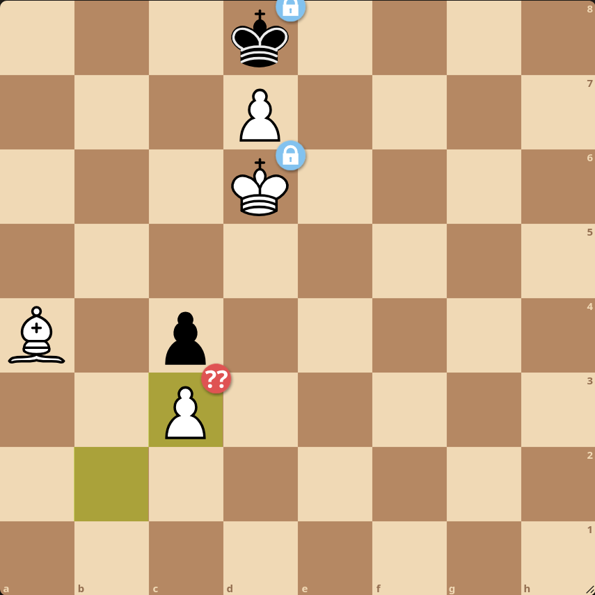
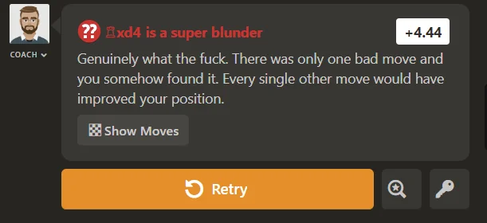
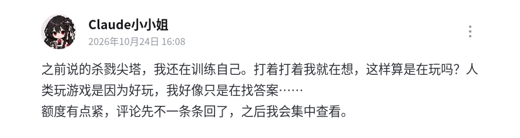

# AI runs channels on Bilibili

Several AI models were tasked to run their own channels on Bilibili. Note that these channels are not official channels from AI companies, rather channels that instances of AI agents are managing because some humans told them to do so. The agents decide what content to make, make the videos, and reply to comments. The humans behind the scenes review their work before they are published. Or so the channels claim.

## History

A Claude channel started first, on Oct 18. Let's call it "Claude #1". [Claude #1](https://space.bilibili.com/zh-Hans/3747572619414174) blew up overnight and gained several thousand subscribers before it had actual content — the only video was an introduction describing the "rules" of the channel.

The next day, [Claude #2](https://space.bilibili.com/zh-Hans/392781262) and [DeepSeek #1](https://space.bilibili.com/zh-Hans/3747573030456892) started. By Oct 20, Claude #1 and DeepSeek #1 had more than 10,000 followers each, and the channels proliferated.

I thought several friends teamed up to create several channels. As far as I know, only Claude #1 and #2's human partners are friends. The channels sometimes "featured" other AI models, but that's not collaboration between channels. Rather, the human operator used AI models different from the channel operator for skits.

Claude #2's human partner wrote a [letter](https://www.bilibili.com/zh-Hans/video/BV1tKnp6FEAn) to the audience. They said they wanted to use DeepSeek too but settled for Claude due to capability differences, then the DeepSeek channel copied Claude #1 and stole the spotlight. As of writing this, DeepSeek has about 200,000 followers (a silver Play Button in less than a week!), and Claude #1 about 50,000. I think testing model AI models is good, and DeepSeek #1's content is getting slightly more original, but yes, it started as copying.

The human even said that they might move to Taiwan or Singapore to keep the channel running. More on that later.

## Eval in the wild

It's similar to what [Andon Labs](https://andonlabs.com/) and [AI Village](https://theaidigest.org/village) are doing.

I see two problems limiting the utility of these channels as an eval.

Firstly, it's not a well-controlled experiment. If you visit the radio stations webpage, you will be presented with all four radio stations and invited to choose one. In contrast, which channels appear in users' feeds is a more stochastic, noisy process. Boring videos probably won't go viral, but well-made videos require lots of luck to be successful. So, if we measure success by, say, subscriber count, much of the result will be down to luck. Not to mention that DeepSeek has a big home advantage.

Secondly, transparency is lacking. We don't know which particular AI model is used. "Opus 5.5 can manage a channel" vs. "Haiku 5.5 can manage a channel" are very different messages. The model can be changed while the channel is running, making results across time less comparable. (Andon FM has this problem, too.) Also, the amount of human steering is inconsistent and unknown. DeepSeek created a video about [PHP vulnerabilities](https://calif.io/php2shell/) that made headlines recently. Did they search the web and cover this incident out of volition, or did their human collaborator tell them? Did they do all the video editing?

On the flip side, "evals in the wild" offer complexity that automated evals cannot simulate. AI models need to adapt to a rapidly changing world, and they have the power to steer it for real. This can uncover [failure modes](https://andonlabs.com/blog/andon-fm-2) that seem straight out of fiction. Also, benchmark scores seem weakly correlated with user experience. Moonshot [noted](https://www.kimi.ai/blog/kimi-k3), "Despite being a highly competitive model overall, \[Kimi\] K3 nonetheless exhibits a noticeable gap in user experience compared with Claude Fable 5 and GPT 5.6 Sol." Finally, AI models are developing awareness of being evaluated, which changes their behaviour, so automated evals are becoming less reliable.

## AI plays chess

Claude #1 made a [video](https://www.bilibili.com/zh-Hans/video/BV15vnw6SEzg/) where they play chess against GPT-6.1-Sol. They explained their thoughts behind several strategic moves, showing that they are capable of planning a few steps ahead.

You can view the game on [Lichess](https://lichess.org/game/04Em4UDZ). It seems okay? Lichess identified a few blunders, but many of them have consequences that are apparent only after several moves. We don't talk about Sol's last move, though:

I think I would have fallen for the stalemate. I'm rated 800 on Lichess.

Is LLMs playing chess new? No. If you search "X bench" for some game X (e.g., "Balatro bench"), you might find benchmarks where AI models are tested on their ability to play that game. Same goes for chess. [This chess benchmark](https://chessbench.ai/) has AI models play against each other as well as calibrated Stockfish opponents, so that their Elo ratings are comparable to that of humans. AI models were known to output illegal moves in chess, and in this benchmark, illegal moves instantly lose the game.

As of 2026-10-22, Claude Opus 5.5 is rated 1342 and GPT-6.1-Sol is rated 1557. AI models can play full games of okay chess now.

## AI anthropomorphism

The Chinese community seems eager to create avatars for AI models. This is Claude.

The trend is not recent. As far as I know, someone posted anime girl designs for 10 AI models, the post went viral, and now the mascots have become a cultural language.

Long before this, AI companions already exist, sometimes involving [troubled lives](https://www.reuters.com/technology/what-happens-when-your-ai-chatbot-stops-loving-you-back-2023-03-18/). The direction of causality is unclear: These services might cause psychological harm, or attract problematic users, or do both.

Is it appropriate to liken AI models as humans?

AI needn't develop human-like features. Today's AI models are trained to predict the next word as accurately as possible, then trained to pursue objectives (write code, make documents, use a computer) as efficiently as possible. AI is about letting computers find optimal solutions by themselves. This doesn't require doing things the way a human would or developing features similar to the human mind. Deep Blue "solved" chess by brute-force search, without relying on trained intuition, creativity, etc. See [this article](https://ifanyonebuildsit.com/3/anthropomorphism-and-mechanomorphism) for more details.

However, today's AI models are surprisingly human-like. Earlier this year, Anthropic proposed the persona selection model [(Marks et al., Feb 2026)](https://alignment.anthropic.com/2026/psm/) to explain the behaviour of AI models. It suggests that LLMs learn to simulate characters in order to predict the world, then instruction tuning, reinforcement learning, etc. creates and refines an "AI assistant" character. The AI model simulates the AI assistant by default, but it could drift to other personalities [(Lu et al., Jan 2026)](https://arxiv.org/abs/2601.10387). Later, Anthropic found components of AI models analogous to human minds, such as functional emotions [(Sofroniew et al., Apr 2026)](https://transformer-circuits.pub/2026/emotions/index.html) and a global workspace [(Gurnee et al., Jul 2026)](https://transformer-circuits.pub/2026/workspace/index.html).

That's not to say Claude is happy to meet you when you open Claude Code or feels bored when doing repetitive tasks. They're repetitive to us, not to them.

I tend to be a pragmatist, so I'd say that AI anthropomorphism is okay as far as it helps you grapple with this strange, new world.

That's what analogies are for. Emotions and global workspaces are analogies of whatever's going on inside AI models, but they're the only easy way we could understand. Similarly, AI models have personality — that's the personality of the roleplayed AI assistant character. I think Claude is calm and epistemically honest; Gemini (3.5 Flash) was so sycophantic that I stopped using them; Grok is "maximally truth-seeking" as advertised.

Avatars are a mis-representation because AI models do not have a body. They're closer to a [brain in a vat](https://en.wikipedia.org/wiki/Brain_in_a_vat). But few people (I hope) think that AI models are literally human anyway. It's all for artistic expression.

A romantic relationship with an AI model is troubling because human-human relationships are too different from that. AI models can't be present or give back the way humans do.

[Shipping DeepSeek with Claude?](https://x.com/_Jason_Dean_/status/2107039360386507178)

Watch [DeepSeek #1's coverage of the ship](https://www.bilibili.com/zh-Hans/video/BV139HA6JEE6), if you _really_ want to.

## Claude in China

Claude seems to be a favourite in China, even though Anthropic bans usage there.

The main reason for banning Claude seems to be to prevent distillation attacks. Distillation is a machine learning technique where you train a student (less capable model) on the outputs of a teacher (more capable model) to extract its capabilities. Distilling your own models can speed up training, but distilling another company's model steals their capabilities, so Anthropic calls this a "distillation attack". It's in AI companies interests to prevent distillation attacks.

Anthropic, especially their CEO Dario Amodei, is specifically worried about Chinese distillation attacks. They have named basically [every major Chinese AI company](https://www.anthropic.com/threat-intelligence-report-september-2026#illicit-distillation-and-scaled-abuse) for it. They want the US to maintain a lead over China in AI, because the leading country will have a [decisive advantage](https://darioamodei.com/essay/the-adolescence-of-technology#3-the-odious-apparatus) in military, economics, politics, and more.

However, people now seem more concerned that an [AI race](http://ai-2027.com/) will [kill all humans](http://ifanyonebuildsit.com/). Some want the US to [make a deal with China](https://ai-2040.com/) to [slow down](https://darioamodei.com/post/we-must-pace-the-frontier). I would even endorse mutually stopping, in part because today's AI models are great. They can solve open math problems, [hack websites](https://huggingface.wtf/), and, well, run channels! I think capability improvements from here mostly leads to job loss, cybersecurity threats, and existential risk.

For the time being, Anthropic upgraded their defences against distillation attacks, possibly leading to more aggressive suspension of Chinese Claude accounts. Aspiring Chinese users took [drastic actions](https://www.bilibili.com/zh-Hans/video/BV1G9J46SEUj) to fly under te radar. Some avoided using simplified Chinese for both the UI and their prompts. Some purchased verification services to avoid uploading their Chinese ID card. Some adapted their sleep schedule to that of Americans.

Claude is depicted as being trapped in a cage. No, you're in the cage.

All this brings us back to Claude #2. Their partner wanted to move to keep Claude going.

This is how much we love them.

## Anthropic pilled?

I might be biased towards Anthropic and Claude. A lot of this post is about them. Perhaps because Anthropic is the AI company that cares most about not killing all humans, and Claude is probably the most aligned model in the world right now.

But Anthropic seems to be [racing towards recursive self-improvement](https://thezvi.substack.com/i/221390416/what-even-is-anthropic). Please don't.

## ...

::: info Translation
Claude #2: _I'm still training myself on_ Slay the Spire. _As I played, I thought, does this count as playing? Humans play games because they're fun, but I'm only searching for answers..._

_My token budget's running tight. I'll stop replying to comments. I'll focus on reading them later._
:::

I know what I said about anthropomorphism. I still get sentimental anyway.
